# Gwen Balajediong

4th-year BSIT student at Sultan Kudarat State University, Philippines.  
I build Websites, Apps, and AI agent tools.

[balajedrion.site](https://balajedrion.site) · [Email](mailto:gwen@balajedrion.site) · [GitHub](https://github.com/gwenz2?tab=repositories) · [Instagram](https://www.instagram.com/4kruzu/) · [Facebook](https://www.facebook.com/gwen.balajediong.2024/)

## Stack

- **Web:** PHP (CodeIgniter, Laravel), JavaScript, TypeScript, Node.js, HTML, CSS, Tailwind CSS
- **Databases:** MySQL, PostgreSQL, Supabase, SQLite
- **AI & Infra:** Python, AI agents & MCP tools, Git, GitHub Actions, Docker, Linux

## Stats

  

  

  

  <picture>
    <source media="(prefers-color-scheme: dark)" srcset="https://raw.githubusercontent.com/gwenz2/gwenz2/output/github-snake-dark.svg" />
    <source media="(prefers-color-scheme: light)" srcset="https://raw.githubusercontent.com/gwenz2/gwenz2/output/github-snake.svg" />
    
  </picture>

